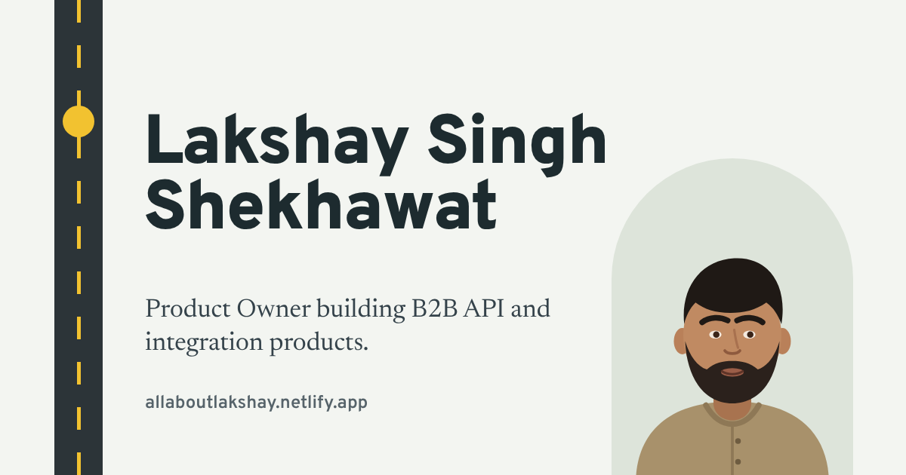

# allaboutlakshay

My portfolio, live at **[allaboutlakshay.netlify.app](https://allaboutlakshay.netlify.app)**.



I'm a Product Owner who builds B2B API and integration products for US freight. The site walks through that work as a route: scroll down and a small version of me walks the road, each section is a stop, and every stop you reach adds to a score. Scroll back up and the score comes back down. If you'd rather skip the game, the resume is one click from the top.

**What's on it:** four stories of things I've shipped, the side projects I'm building now, and the PRDs I wrote in my product management program.

**How it's built:** [Astro](https://astro.build) for a fast static site, with plain CSS and no UI framework. The walking character and scoring are about 75 lines of vanilla JavaScript. It respects reduced-motion settings and scores 100 on accessibility. Hosted on Netlify.

```bash
npm install
npm run dev    # http://localhost:4321
```

How to edit the content is in [EDITING.md](EDITING.md).
